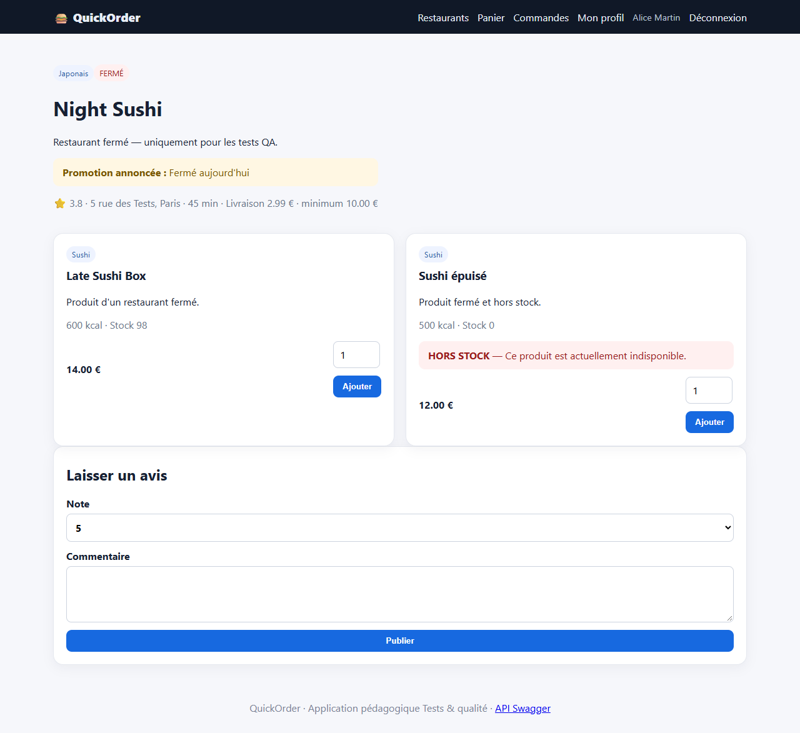
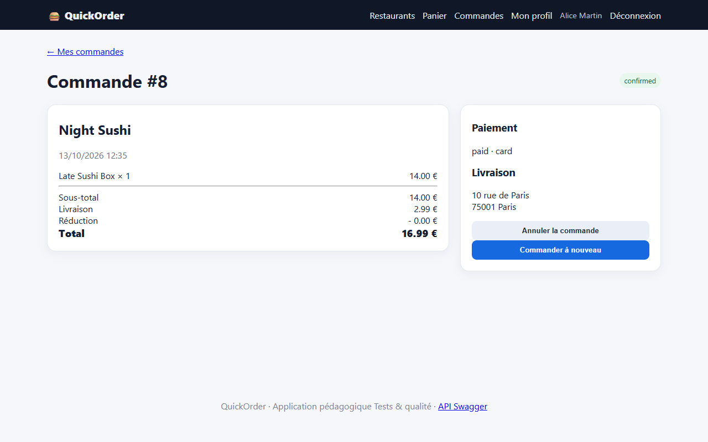
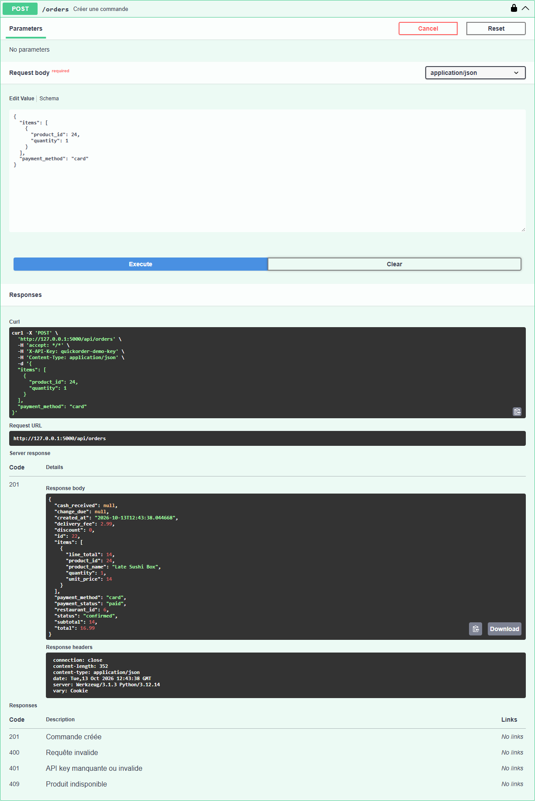

# BUG-01 : Un restaurant affiché FERMÉ accepte les commandes (UI et API)

| Sévérité | Priorité | Statut | Cas de test liés |
|---|---|---|---|
| Critique | P1 | Ouvert | RM-01 |

## Contexte

Parcours de commande. Le restaurant Night Sushi (id 6) est affiché avec le badge « FERMÉ » et la mention « Fermé aujourd'hui », mais rien n'empêche de commander.

Testé sur QuickOrder V3.1 sous Docker Compose (http://127.0.0.1:5000), base créée par seed.py, Microsoft Edge, le 13/10/2026.

## Préconditions

Compte alice@example.com connecté. Panier vide.

## Étapes de reproduction

1. Ouvrir http://127.0.0.1:5000/restaurant/6 (Night Sushi, badge FERMÉ).
2. Cliquer « Ajouter » sur Late Sushi Box.
3. Ouvrir le panier, cliquer « Passer commande ».
4. Laisser « Carte bancaire », cliquer « Confirmer ».
5. Variante API : `POST /api/orders` avec `{"items":[{"product_id":24,"quantity":1}],"payment_method":"card"}`.

## Résultat attendu

L'ajout au panier ou la validation est refusé avec un message « restaurant fermé ». L'API répond 409. Aucune commande n'est créée.

## Résultat obtenu

UI : « Commande confirmée ! », commande #8 au statut confirmed, payée, 16,99 €. API : HTTP 201, commande #9 créée.

## Impact

Le client est débité pour une commande qui ne sera jamais préparée : remboursements, support, perte de confiance.

## Preuves







Échanges HTTP du cas RM-01 (fichier complet : [evidence/RM-01.txt](evidence/RM-01.txt))

```text
> POST /login
< 302 -> / ; 200 /
> POST /cart/clear
< 302 -> /cart ; 200 /cart
  message affiché : [info] Panier vidé.
> POST /cart/add/24
< 302 -> / ; 200 /
  message affiché : [success] Late Sushi Box ajouté au panier.
> GET /checkout
< 200 /checkout
# adresse proposée au checkout : «Domicile — 10 rue de Paris, 75001 Paris»
> POST /checkout
< 302 -> /orders/8 ; 200 /orders/8
  message affiché : [success] Commande confirmée !
# page commande : {'status': 'confirmed', 'total': '16.99', 'discount': '0.00', 'change': None, 'payment': 'paid · card'}
> POST /api/orders
  body: {"items": [{"product_id": 24, "quantity": 1}], "payment_method": "card"}
< 201 (application/json)
  {"cash_received": null, "change_due": null, "created_at": "2026-10-13T12:35:25.248460", "delivery_fee": 2.99, "discount": 0.0, "id": 9, "items": [{"line_total": 14.0, "product_id": 24, "product_name": "Late Sushi Box", "quantity": 1, "unit_price": 14.0}], "payment_method": "card", "payment_status": "paid", "restaurant_id": 6, "status": "confirmed", "subtotal": 14.0, "total": 16.99}
# RÉSULTAT ATTENDU : Ajout au panier ou validation refusés (UI) ; HTTP 409 (API) ; aucune commande créée.
# RÉSULTAT OBTENU  : UI : commande #8 créée, statut confirmed, total 16.99 € ; API : HTTP 201 commande #9.
# STATUT           : Fail
```
