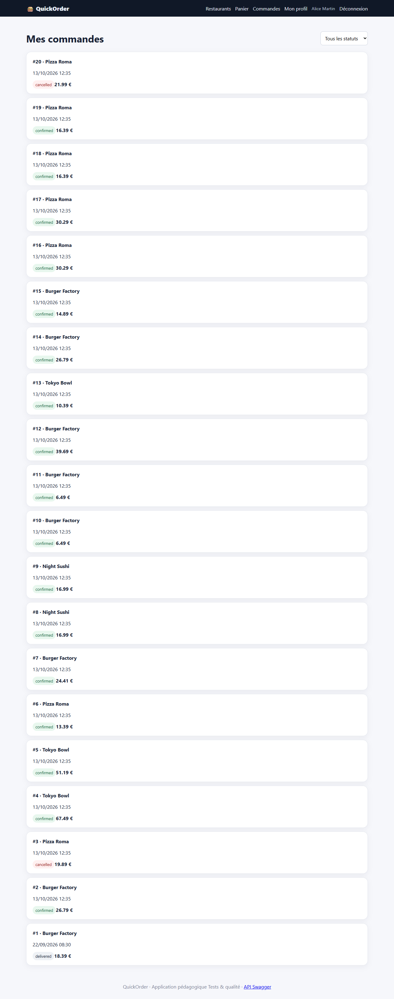
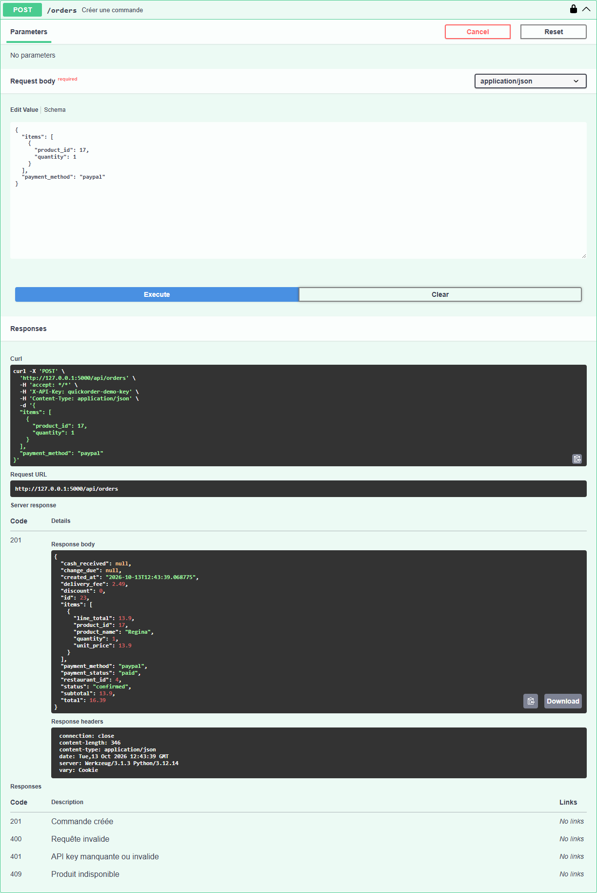

# BUG-02 : Un paiement PayPal crée deux commandes identiques

| Sévérité | Priorité | Statut | Cas de test liés |
|---|---|---|---|
| Critique | P1 | Ouvert | RM-05 |

## Contexte

Checkout, mode de paiement PayPal, depuis l'interface comme depuis l'API.

Testé sur QuickOrder V3.1 sous Docker Compose (http://127.0.0.1:5000), base créée par seed.py, Microsoft Edge, le 13/10/2026.

## Préconditions

Compte alice@example.com connecté. Noter le nombre de commandes dans « Commandes ».

## Étapes de reproduction

1. Ajouter 2 Regina (Pizza Roma) au panier.
2. Passer commande, choisir « PayPal », confirmer.
3. Ouvrir « Commandes ».
4. Variante API : `POST /api/orders` avec `{"items":[{"product_id":17,"quantity":1}],"payment_method":"paypal"}` puis `GET /api/orders`.

## Résultat attendu

Une seule commande et un seul paiement ; le stock diminue de la quantité commandée.

## Résultat obtenu

UI : 2 commandes identiques (#16 et #17, 30,29 € chacune, toutes deux « paid ») ; le stock de Regina passe de 100 à 96 pour 2 unités commandées. API : 2 commandes (#18 et #19) pour un seul appel, stock 96 → 94 pour 1 unité.

## Impact

Double débit du client, double préparation en cuisine, stock faussé. Touche 100 % des paiements PayPal.

## Preuves





Échanges HTTP du cas RM-05 (fichier complet : [evidence/RM-05.txt](evidence/RM-05.txt))

```text
< 302 -> /cart ; 200 /cart
  message affiché : [info] Panier vidé.
> POST /cart/add/17
< 302 -> / ; 200 /
  message affiché : [success] Regina ajouté au panier.
> GET /checkout
< 200 /checkout
# adresse proposée au checkout : «Domicile — 10 rue de Paris, 75001 Paris»
> POST /checkout
< 302 -> /orders/16 ; 200 /orders/16
  message affiché : [success] Commande confirmée !
> GET /api/orders
< 200 (application/json)
> GET /api/products/17
< 200 (application/json)
  {"available": true, "calories": 840, "category": "Pizzas", "description": "Tomate, mozzarella, jambon, champignons", "id": 17, "is_vegetarian": false, "name": "Regina", "price": 13.9, "restaurant_id": 4, "stock": 96}
> POST /api/orders
  body: {"items": [{"product_id": 17, "quantity": 1}], "payment_method": "paypal"}
< 201 (application/json)
  {"cash_received": null, "change_due": null, "created_at": "2026-10-13T12:35:26.400417", "delivery_fee": 2.49, "discount": 0.0, "id": 18, "items": [{"line_total": 13.9, "product_id": 17, "product_name": "Regina", "quantity": 1, "unit_price": 13.9}], "payment_method": "paypal", "payment_status": "paid", "restaurant_id": 4, "status": "confirmed", "subtotal": 13.9, "total": 16.39}
> GET /api/orders
< 200 (application/json)
> GET /api/products/17
< 200 (application/json)
  {"available": true, "calories": 840, "category": "Pizzas", "description": "Tomate, mozzarella, jambon, champignons", "id": 17, "is_vegetarian": false, "name": "Regina", "price": 13.9, "restaurant_id": 4, "stock": 94}
# RÉSULTAT ATTENDU : Exactement 1 commande supplémentaire par paiement ; stock décrémenté une seule fois.
# RÉSULTAT OBTENU  : UI : commandes 15 → 17 (+2) pour un seul paiement, stock Regina 100 → 96 (2 commandés) ; API : commandes 17 → 19 (+2), stock 96 → 94 (1 commandé).
# STATUT           : Fail
```
