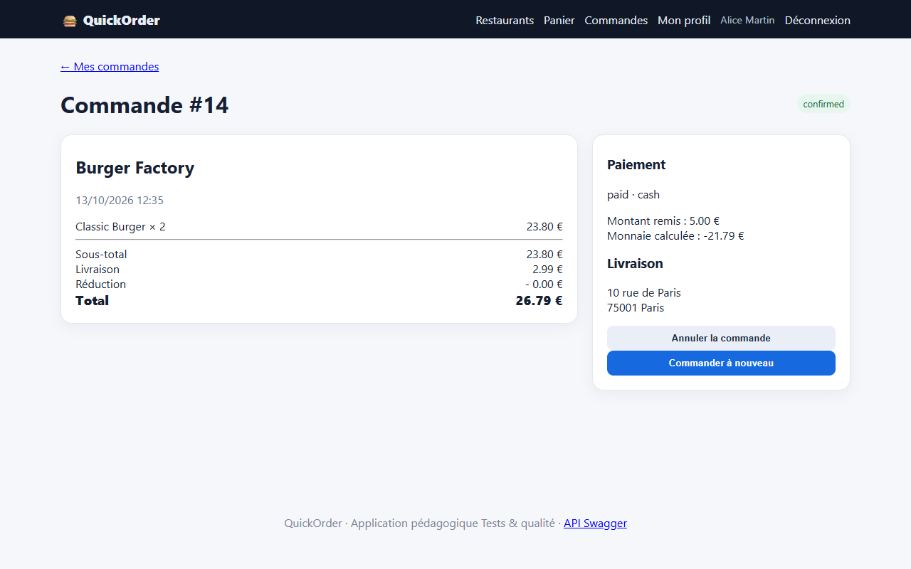
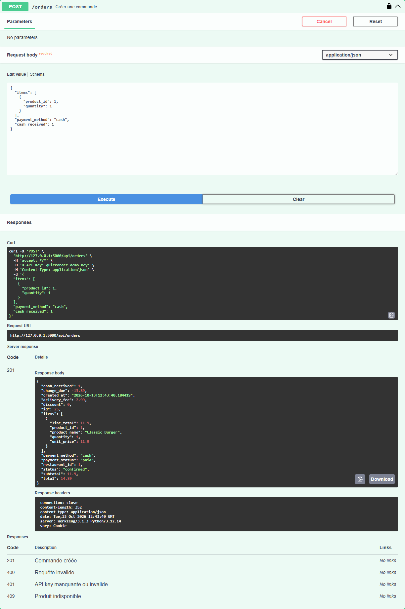

# BUG-03 : Paiement en espèces accepté avec un montant inférieur au total

| Sévérité | Priorité | Statut | Cas de test liés |
|---|---|---|---|
| Critique | P1 | Ouvert | RM-04 |

## Contexte

Checkout, mode de paiement « Espèces », champ « Montant remis en espèces ».

Testé sur QuickOrder V3.1 sous Docker Compose (http://127.0.0.1:5000), base créée par seed.py, Microsoft Edge, le 13/10/2026.

## Préconditions

Compte alice@example.com connecté. Panier : 2 Classic Burger (total 26,79 € livraison incluse).

## Étapes de reproduction

1. Passer commande, choisir « Espèces ».
2. Saisir 5.00 dans « Montant remis en espèces ».
3. Confirmer.
4. Variante API : `POST /api/orders` avec `"payment_method":"cash","cash_received":1`.

## Résultat attendu

Refus avec un message « montant insuffisant » ; aucune commande marquée payée.

## Résultat obtenu

Commande #14 confirmée, paiement « paid · cash », montant remis 5,00 €, monnaie calculée −21,79 €. API : HTTP 201, payment_status paid, change_due −13,89 (commande #15).

## Impact

Une commande est considérée payée alors que le montant ne couvre pas le total ; une monnaie à rendre négative est affichée au client.

## Preuves





Échanges HTTP du cas RM-04 (fichier complet : [evidence/RM-04.txt](evidence/RM-04.txt))

```text
> POST /login
< 302 -> / ; 200 /
> POST /cart/clear
< 302 -> /cart ; 200 /cart
  message affiché : [info] Panier vidé.
> POST /cart/add/1
< 302 -> / ; 200 /
  message affiché : [success] Classic Burger ajouté au panier.
> GET /checkout
< 200 /checkout
# adresse proposée au checkout : «Domicile — 10 rue de Paris, 75001 Paris»
> POST /checkout
< 302 -> /orders/14 ; 200 /orders/14
  message affiché : [success] Commande confirmée !
# page commande : {'status': 'confirmed', 'total': '26.79', 'discount': '0.00', 'change': '-21.79', 'payment': 'paid · cash'}
> POST /api/orders
  body: {"items": [{"product_id": 1, "quantity": 1}], "payment_method": "cash", "cash_received": 1}
< 201 (application/json)
  {"cash_received": 1.0, "change_due": -13.89, "created_at": "2026-10-13T12:35:26.060948", "delivery_fee": 2.99, "discount": 0.0, "id": 15, "items": [{"line_total": 11.9, "product_id": 1, "product_name": "Classic Burger", "quantity": 1, "unit_price": 11.9}], "payment_method": "cash", "payment_status": "paid", "restaurant_id": 1, "status": "confirmed", "subtotal": 11.9, "total": 14.89}
# RÉSULTAT ATTENDU : Commande refusée avec message « montant insuffisant » ; aucune commande payée.
# RÉSULTAT OBTENU  : UI : commande #14 confirmed « paid · cash », total 26.79 €, monnaie calculée -21.79 € ; API : HTTP 201, payment_status paid, change_due -13.89.
# STATUT           : Fail
```
