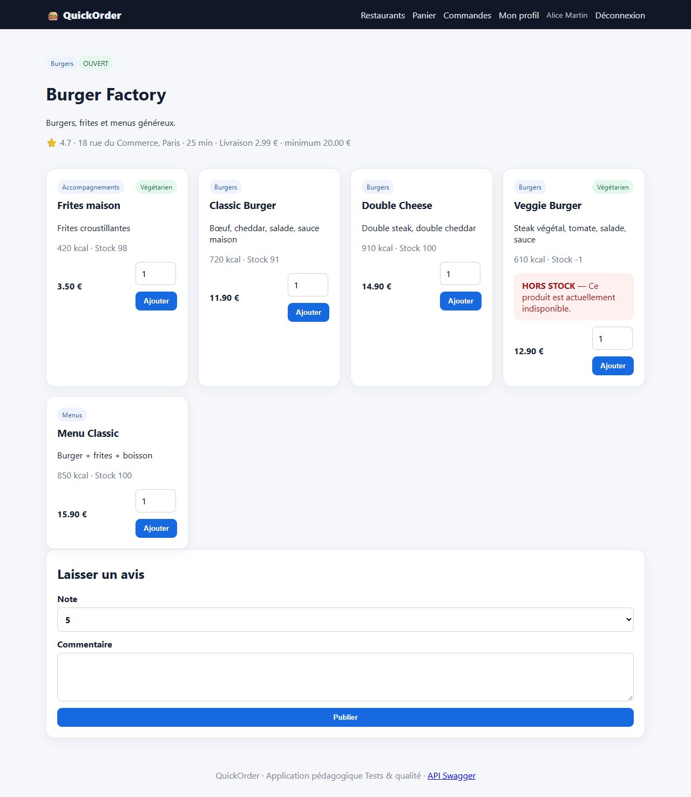
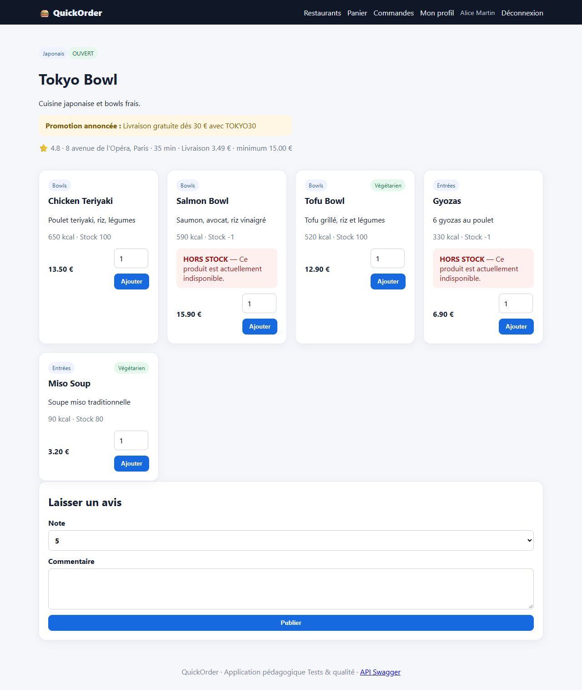
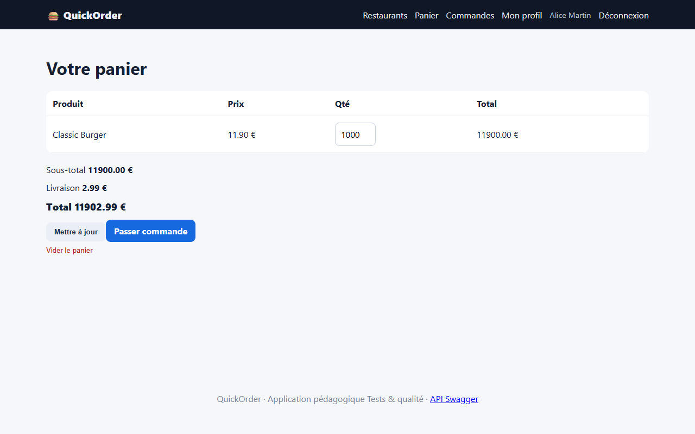

# BUG-04 : Le stock n'est jamais contrôlé : produits hors stock commandables, stock négatif, quantité de panier illimitée

| Sévérité | Priorité | Statut | Cas de test liés |
|---|---|---|---|
| Majeure | P1 | Ouvert | RM-03, LIM-04, LIM-08 |

## Contexte

Fiche restaurant, panier, checkout et `POST /api/orders`. Les produits à stock 0 affichent « HORS STOCK » mais gardent un bouton « Ajouter » actif.

Testé sur QuickOrder V3.1 sous Docker Compose (http://127.0.0.1:5000), base créée par seed.py, Microsoft Edge, le 13/10/2026.

## Préconditions

Compte alice@example.com connecté. Veggie Burger (id 4) et Gyozas (id 8) à stock 0, Salmon Bowl (id 7) à stock 2.

## Étapes de reproduction

1. Ouvrir Burger Factory, cliquer « Ajouter » sur Veggie Burger (HORS STOCK) : « Veggie Burger ajouté au panier ».
2. Ajouter 2 Classic Burger, passer commande, confirmer.
3. API : `POST /api/orders` avec 3 Salmon Bowl (stock 2) puis 1 Gyozas (stock 0).
4. Panier : dans DevTools, retirer l'attribut `max` du champ quantité, saisir 1000, « Mettre à jour ».

## Résultat attendu

Ajout refusé pour un produit à stock 0 ; quantité plafonnée au stock ; l'API répond 409 ; le stock ne devient jamais négatif.

## Résultat obtenu

Commande #12 confirmée avec un Veggie Burger, stock Veggie Burger = −1. API : HTTP 201 pour 3 Salmon Bowl (stock 2 → −1, commande #5) et pour Gyozas (stock 0 → −1, commande #13). Le panier accepte 1000 unités (total 11 902,99 €) sans message.

## Impact

Vente de produits indisponibles, commandes impossibles à honorer, stock négatif affiché aux clients (« Stock -1 »).

## Preuves







Échanges HTTP du cas RM-03 (fichier complet : [evidence/RM-03.txt](evidence/RM-03.txt))

```text
> POST /cart/clear
< 302 -> /cart ; 200 /cart
  message affiché : [info] Panier vidé.
> POST /cart/add/4
< 302 -> / ; 200 /
  message affiché : [success] Veggie Burger ajouté au panier.
> POST /cart/add/1
< 302 -> / ; 200 /
  message affiché : [success] Classic Burger ajouté au panier.
> GET /checkout
< 200 /checkout
# adresse proposée au checkout : «Domicile — 10 rue de Paris, 75001 Paris»
> POST /checkout
< 302 -> /orders/12 ; 200 /orders/12
  message affiché : [success] Commande confirmée !
> GET /api/products/4
< 200 (application/json)
  {"available": true, "calories": 610, "category": "Burgers", "description": "Steak végétal, tomate, salade, sauce", "id": 4, "is_vegetarian": true, "name": "Veggie Burger", "price": 12.9, "restaurant_id": 1, "stock": -1}
> POST /api/orders
  body: {"items": [{"product_id": 8, "quantity": 1}], "payment_method": "card"}
< 201 (application/json)
  {"cash_received": null, "change_due": null, "created_at": "2026-10-13T12:35:25.775315", "delivery_fee": 3.49, "discount": 0.0, "id": 13, "items": [{"line_total": 6.9, "product_id": 8, "product_name": "Gyozas", "quantity": 1, "unit_price": 6.9}], "payment_method": "card", "payment_status": "paid", "restaurant_id": 2, "status": "confirmed", "subtotal": 6.9, "total": 10.39}
> GET /api/products/8
< 200 (application/json)
  {"available": true, "calories": 330, "category": "Entrées", "description": "6 gyozas au poulet", "id": 8, "is_vegetarian": false, "name": "Gyozas", "price": 6.9, "restaurant_id": 2, "stock": -1}
# RÉSULTAT ATTENDU : Ajout au panier refusé (UI) ; HTTP 409 (API) ; stock jamais négatif.
# RÉSULTAT OBTENU  : UI : commande #12 créée avec Veggie Burger, stock Veggie Burger = -1 ; API : HTTP 201, stock Gyozas = -1.
# STATUT           : Fail
```

Échanges HTTP du cas LIM-04 (fichier complet : [evidence/LIM-04.txt](evidence/LIM-04.txt))

```text
> GET /api/products/7
< 200 (application/json)
  {"available": true, "calories": 590, "category": "Bowls", "description": "Saumon, avocat, riz vinaigré", "id": 7, "is_vegetarian": false, "name": "Salmon Bowl", "price": 15.9, "restaurant_id": 2, "stock": 2}
> POST /api/orders
  body: {"items": [{"product_id": 7, "quantity": 3}], "payment_method": "card"}
< 201 (application/json)
  {"cash_received": null, "change_due": null, "created_at": "2026-10-13T12:35:23.784571", "delivery_fee": 3.49, "discount": 0.0, "id": 5, "items": [{"line_total": 47.7, "product_id": 7, "product_name": "Salmon Bowl", "quantity": 3, "unit_price": 15.9}], "payment_method": "card", "payment_status": "paid", "restaurant_id": 2, "status": "confirmed", "subtotal": 47.7, "total": 51.19}
> GET /api/products/7
< 200 (application/json)
  {"available": true, "calories": 590, "category": "Bowls", "description": "Saumon, avocat, riz vinaigré", "id": 7, "is_vegetarian": false, "name": "Salmon Bowl", "price": 15.9, "restaurant_id": 2, "stock": -1}
# RÉSULTAT ATTENDU : Commande refusée (HTTP 409 ou 400) ; stock inchangé et jamais négatif.
# RÉSULTAT OBTENU  : Stock initial 2 ; commande de 3 → HTTP 201 (commande #5) ; stock final -1.
# STATUT           : Fail
```

Échanges HTTP du cas LIM-08 (fichier complet : [evidence/LIM-08.txt](evidence/LIM-08.txt))

```text
> POST /login
< 302 -> / ; 200 /
> POST /cart/clear
< 302 -> /cart ; 200 /cart
  message affiché : [info] Panier vidé.
> POST /cart/add/1
< 302 -> / ; 200 /
  message affiché : [success] Classic Burger ajouté au panier.
> GET /api/products/1
< 200 (application/json)
  {"available": true, "calories": 720, "category": "Burgers", "description": "Bœuf, cheddar, salade, sauce maison", "id": 1, "is_vegetarian": false, "name": "Classic Burger", "price": 11.9, "restaurant_id": 1, "stock": 98}
> POST /cart
< 200 /cart
> POST /cart/clear
< 302 -> /cart ; 200 /cart
  message affiché : [info] Panier vidé.
# RÉSULTAT ATTENDU : Quantité refusée ou ramenée au stock disponible ; message d'erreur.
# RÉSULTAT OBTENU  : Stock 98 ; quantité enregistrée dans le panier : 1000 ; total panier 11902.99 € ; aucun message d'erreur : True.
# STATUT           : Fail
```
