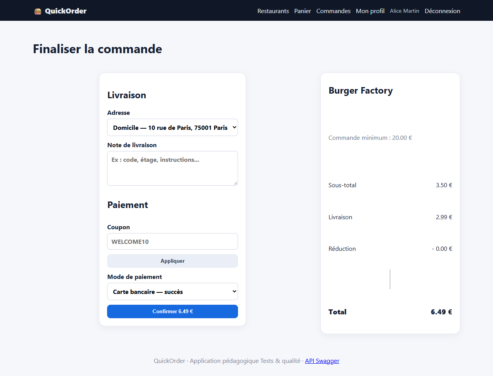
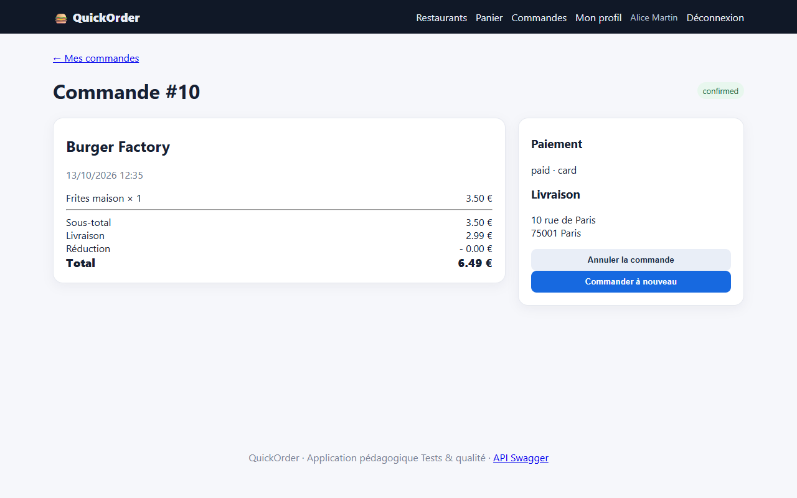
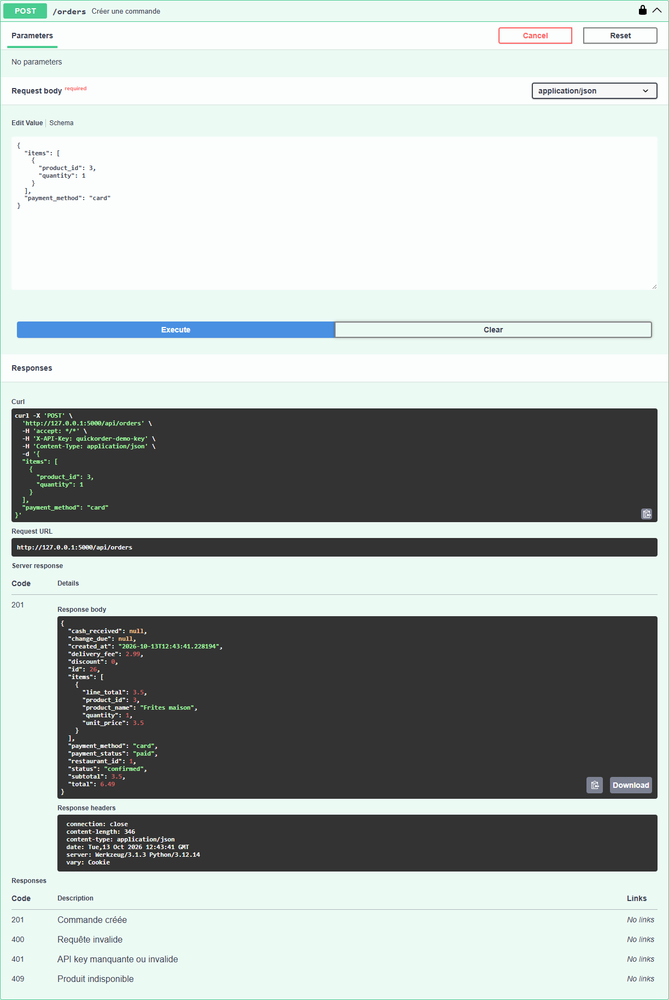

# BUG-05 : Le minimum de commande est affiché mais jamais appliqué

| Sévérité | Priorité | Statut | Cas de test liés |
|---|---|---|---|
| Majeure | P1 | Ouvert | RM-02 |

## Contexte

Checkout. La page affiche « Commande minimum : 20.00 € » pour Burger Factory.

Testé sur QuickOrder V3.1 sous Docker Compose (http://127.0.0.1:5000), base créée par seed.py, Microsoft Edge, le 13/10/2026.

## Préconditions

Compte alice@example.com connecté. Panier vide.

## Étapes de reproduction

1. Ajouter 1 Frites maison (3,50 €) chez Burger Factory.
2. Passer commande : le récapitulatif affiche « Commande minimum : 20.00 € » et un sous-total de 3,50 €.
3. Confirmer.
4. Variante API : `POST /api/orders` avec `{"items":[{"product_id":3,"quantity":1}],"payment_method":"card"}`.

## Résultat attendu

Validation bloquée avec un message indiquant le montant manquant.

## Résultat obtenu

Commande #10 confirmée pour 6,49 € (sous-total 3,50 €). API : HTTP 201, commande #11.

## Impact

Règle commerciale des restaurants non respectée : livraisons non rentables.

## Preuves







Échanges HTTP du cas RM-02 (fichier complet : [evidence/RM-02.txt](evidence/RM-02.txt))

```text
> POST /login
< 302 -> / ; 200 /
> POST /cart/clear
< 302 -> /cart ; 200 /cart
  message affiché : [info] Panier vidé.
> POST /cart/add/3
< 302 -> / ; 200 /
  message affiché : [success] Frites maison ajouté au panier.
> GET /checkout
< 200 /checkout
# adresse proposée au checkout : «Domicile — 10 rue de Paris, 75001 Paris»
> POST /checkout
< 302 -> /orders/10 ; 200 /orders/10
  message affiché : [success] Commande confirmée !
# page commande : {'status': 'confirmed', 'total': '6.49', 'discount': '0.00', 'change': None, 'payment': 'paid · card'}
> POST /api/orders
  body: {"items": [{"product_id": 3, "quantity": 1}], "payment_method": "card"}
< 201 (application/json)
  {"cash_received": null, "change_due": null, "created_at": "2026-10-13T12:35:25.525024", "delivery_fee": 2.99, "discount": 0.0, "id": 11, "items": [{"line_total": 3.5, "product_id": 3, "product_name": "Frites maison", "quantity": 1, "unit_price": 3.5}], "payment_method": "card", "payment_status": "paid", "restaurant_id": 1, "status": "confirmed", "subtotal": 3.5, "total": 6.49}
# RÉSULTAT ATTENDU : Validation refusée avec message indiquant le minimum ; aucune commande créée.
# RÉSULTAT OBTENU  : UI : commande #10 créée, statut confirmed, total 6.49 € (sous-total 3,50 € < 20 €) ; API : HTTP 201 commande #11.
# STATUT           : Fail
```
