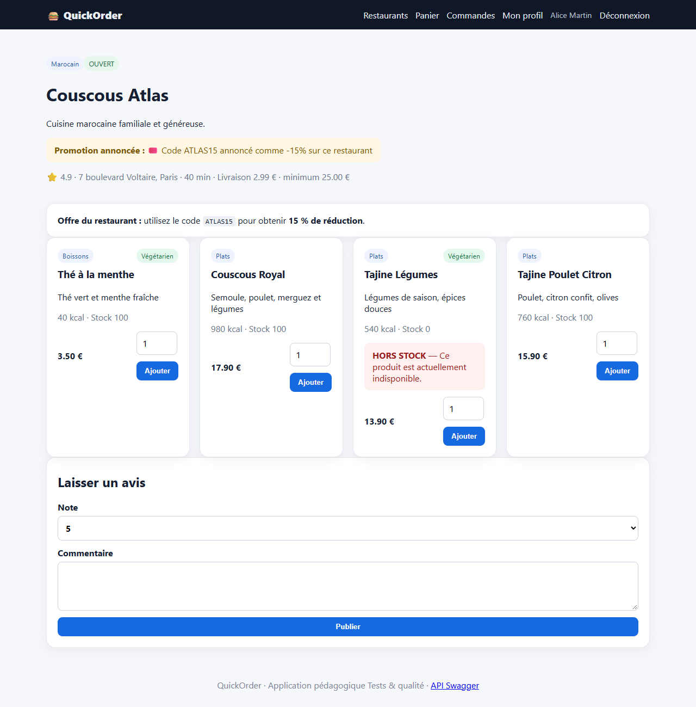
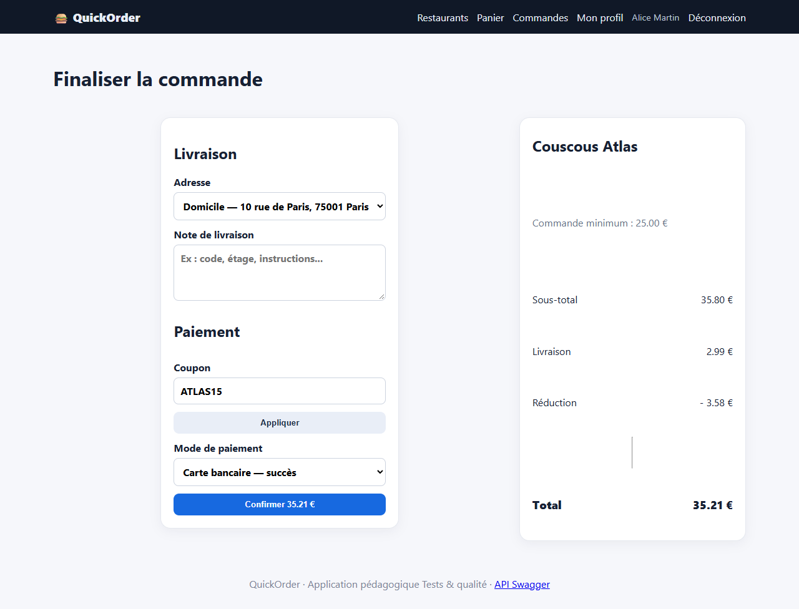

# BUG-06 : Le coupon ATLAS15 applique 10 % alors que 15 % sont annoncés

| Sévérité | Priorité | Statut | Cas de test liés |
|---|---|---|---|
| Majeure | P2 | Ouvert | RM-06 |

## Contexte

Fiche Couscous Atlas : « utilisez le code ATLAS15 pour obtenir 15 % de réduction ».

Testé sur QuickOrder V3.1 sous Docker Compose (http://127.0.0.1:5000), base créée par seed.py, Microsoft Edge, le 13/10/2026.

## Préconditions

Compte alice@example.com connecté. Panier vide.

## Étapes de reproduction

1. Ouvrir Couscous Atlas et lire l'offre.
2. Ajouter 2 Couscous Royal (35,80 €).
3. Au checkout, saisir ATLAS15 et cliquer « Appliquer ».

## Résultat attendu

Réduction de 15 % : 5,37 € ; total 33,42 €.

## Résultat obtenu

Réduction de 3,58 € (10 %) ; total 35,21 €. `POST /api/coupons/validate` renvoie `discount_percent: 10.0`.

## Impact

Promotion trompeuse : risque de réclamations et risque juridique (publicité mensongère).

## Preuves





Échanges HTTP du cas RM-06 (fichier complet : [evidence/RM-06.txt](evidence/RM-06.txt))

```text
> POST /login
< 302 -> / ; 200 /
> GET /restaurant/5
< 200 /restaurant/5
# promotion affichée : utilisez le code ATLAS15 pour obtenir 15 % de réduction.
> POST /cart/clear
< 302 -> /cart ; 200 /cart
  message affiché : [info] Panier vidé.
> POST /cart/add/20
< 302 -> / ; 200 /
  message affiché : [success] Couscous Royal ajouté au panier.
> POST /checkout
< 200 /checkout
# page commande : {'status': None, 'total': '35.21', 'discount': '3.58', 'change': None, 'payment': None}
> POST /api/coupons/validate
  body: {"code": "ATLAS15", "subtotal": 35.8}
< 200 (application/json)
  {"code": "ATLAS15", "discount": 3.58, "discount_percent": 10.0, "valid": true}
> POST /cart/clear
< 302 -> /cart ; 200 /cart
  message affiché : [info] Panier vidé.
# RÉSULTAT ATTENDU : Réduction de 15 % = 5,37 € ; total 35,80 + 2,99 − 5,37 = 33,42 €.
# RÉSULTAT OBTENU  : Réduction appliquée 3.58 € (total 35.21 €) ; l'API annonce discount_percent = 10.0.
# STATUT           : Fail
```
