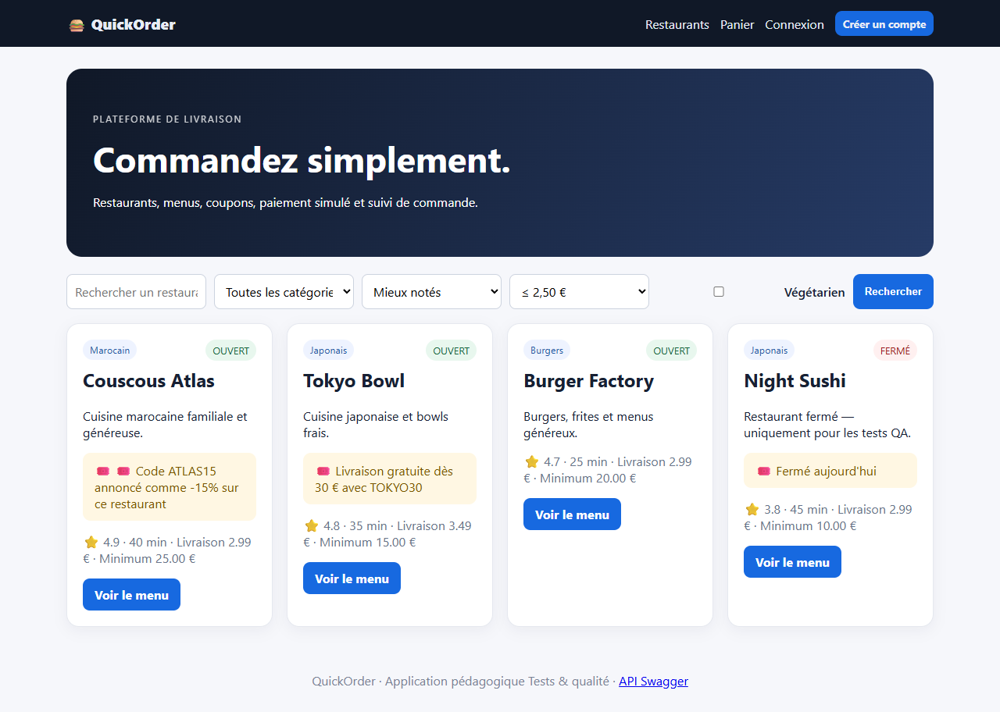

# BUG-07 : Le filtre « Livraison max » renvoie les restaurants les plus chers au lieu des moins chers

| Sévérité | Priorité | Statut | Cas de test liés |
|---|---|---|---|
| Moyenne | P2 | Ouvert | RM-08 |

## Contexte

Page d'accueil, filtre « Livraison max ».

Testé sur QuickOrder V3.1 sous Docker Compose (http://127.0.0.1:5000), base créée par seed.py, Microsoft Edge, le 13/10/2026.

## Préconditions

Aucune (page publique).

## Étapes de reproduction

1. Ouvrir l'accueil.
2. Choisir « ≤ 2,50 € » dans « Livraison max ».
3. Cliquer « Rechercher » (URL : `/?max_delivery=2.50`).

## Résultat attendu

Green Kitchen (1,99 €) et Pizza Roma (2,49 €) uniquement.

## Résultat obtenu

Couscous Atlas (2,99 €), Tokyo Bowl (3,49 €), Burger Factory (2,99 €) et Night Sushi (2,99 €) : exactement les restaurants au-dessus du plafond. Les deux restaurants attendus sont absents.

## Impact

Le filtre donne l'inverse du résultat demandé ; l'utilisateur soucieux du prix est orienté vers les livraisons les plus chères.

## Preuves



Échanges HTTP du cas RM-08 (fichier complet : [evidence/RM-08.txt](evidence/RM-08.txt))

```text
> GET /?max_delivery=2.50
< 200 /?max_delivery=2.50
# restaurants affichés : ['Couscous Atlas', 'Tokyo Bowl', 'Burger Factory', 'Night Sushi']
# RÉSULTAT ATTENDU : Seuls Green Kitchen (1,99 €) et Pizza Roma (2,49 €) sont affichés.
# RÉSULTAT OBTENU  : Restaurants affichés : Couscous Atlas, Tokyo Bowl, Burger Factory, Night Sushi.
# STATUT           : Fail
```
