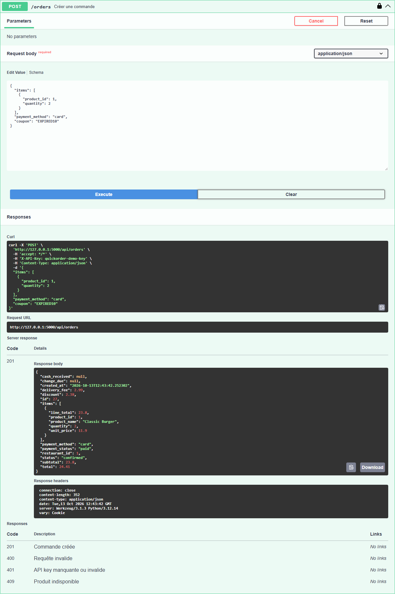

# BUG-08 : `POST /api/orders` applique la réduction d'un coupon expiré

| Sévérité | Priorité | Statut | Cas de test liés |
|---|---|---|---|
| Majeure | P1 | Ouvert | ERR-05, ERR-04 |

## Contexte

API REST. `POST /api/coupons/validate` rejette bien EXPIRED10 (HTTP 404, cas ERR-04), mais la création de commande ne fait pas le même contrôle.

Testé sur QuickOrder V3.1 sous Docker Compose (http://127.0.0.1:5000), base créée par seed.py, Microsoft Edge, le 13/10/2026.

## Préconditions

Clé API `quickorder-demo-key`. Coupon EXPIRED10 expiré.

## Étapes de reproduction

1. `POST /api/coupons/validate` avec `{"code":"EXPIRED10","subtotal":30}` : 404 « Coupon invalide ou expiré ».
2. `POST /api/orders` avec `{"items":[{"product_id":1,"quantity":2}],"payment_method":"card","coupon":"EXPIRED10"}`.

## Résultat attendu

Commande refusée ou créée sans réduction (discount 0, total 26,79).

## Résultat obtenu

HTTP 201, commande #7 avec discount 2,38 et total 24,41.

## Impact

Tout coupon expiré reste utilisable via l'API : perte de chiffre d'affaires, incohérence entre deux endpoints.

## Preuves



Échanges HTTP du cas ERR-05 (fichier complet : [evidence/ERR-05.txt](evidence/ERR-05.txt))

```text
> POST /api/orders
  body: {"items": [{"product_id": 1, "quantity": 2}], "payment_method": "card", "coupon": "EXPIRED10"}
< 201 (application/json)
  {"cash_received": null, "change_due": null, "created_at": "2026-10-13T12:35:24.440627", "delivery_fee": 2.99, "discount": 2.38, "id": 7, "items": [{"line_total": 23.8, "product_id": 1, "product_name": "Classic Burger", "quantity": 2, "unit_price": 11.9}], "payment_method": "card", "payment_status": "paid", "restaurant_id": 1, "status": "confirmed", "subtotal": 23.8, "total": 24.41}
# RÉSULTAT ATTENDU : Commande refusée, ou créée sans réduction (discount 0 ; total 26,79).
# RÉSULTAT OBTENU  : HTTP 201 ; commande #7 ; discount 2.38 ; total 24.41.
# STATUT           : Fail
```

Échanges HTTP du cas ERR-04 (fichier complet : [evidence/ERR-04.txt](evidence/ERR-04.txt))

```text
> POST /api/coupons/validate
  body: {"code": "EXPIRED10", "subtotal": 30}
< 404 (application/json)
  {"error": "Coupon invalide ou expiré.", "valid": false}
> POST /api/coupons/validate
  body: {"code": "INCONNU", "subtotal": 30}
< 404 (application/json)
  {"error": "Coupon invalide ou expiré.", "valid": false}
# RÉSULTAT ATTENDU : valid false dans les deux cas, message « Coupon invalide ou expiré ».
# RÉSULTAT OBTENU  : EXPIRED10 → HTTP 404 valid=False ; INCONNU → HTTP 404 valid=False.
# STATUT           : Pass
```
