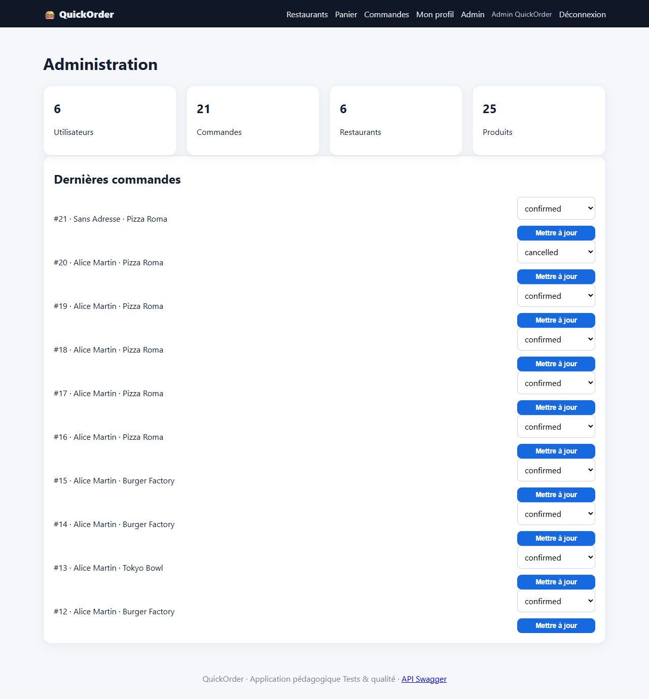

# BUG-09 : L'administration accepte de repasser une commande livrée à « confirmed »

| Sévérité | Priorité | Statut | Cas de test liés |
|---|---|---|---|
| Moyenne | P3 | Ouvert | RM-11 |

## Contexte

Espace administrateur, liste « Dernières commandes ».

Testé sur QuickOrder V3.1 sous Docker Compose (http://127.0.0.1:5000), base créée par seed.py, Microsoft Edge, le 13/10/2026.

## Préconditions

Compte admin@quickorder.local connecté. Commande #1 au statut delivered.

## Étapes de reproduction

1. Ouvrir /admin/.
2. Sur la commande #1, choisir « confirmed ».
3. Cliquer « Mettre à jour ».

## Résultat attendu

Transition refusée : une commande livrée est dans un état final.

## Résultat obtenu

« Statut mis à jour. » ; `GET /api/orders/1` renvoie status confirmed. (La commande a été remise à delivered à la fin du test.)

## Impact

Historique de commande falsifiable ; une commande livrée redevient annulable par le client.

## Preuves



Échanges HTTP du cas RM-11 (fichier complet : [evidence/RM-11.txt](evidence/RM-11.txt))

```text
> POST /login
< 302 -> / ; 200 /
> POST /admin/orders/1/status
< 302 -> /admin/ ; 200 /admin/
  message affiché : [success] Statut mis à jour.
> GET /api/orders/1
< 200 (application/json)
  {"cash_received": null, "change_due": null, "created_at": "2026-09-22T08:30:48.079651", "delivery_fee": 2.99, "discount": 0.0, "id": 1, "items": [{"line_total": 11.9, "product_id": 1, "product_name": "Classic Burger", "quantity": 1, "unit_price": 11.9}, {"line_total": 3.5, "product_id": 3, "product_name": "Frites maison", "quantity": 1, "unit_price": 3.5}], "payment_method": "card", "payment_status": "paid", "restaurant_id": 1, "status": "confirmed", "subtotal": 15.4, "total": 18.39}
# remise en état : la commande #1 est replacée au statut delivered
> POST /admin/orders/1/status
< 302 -> /admin/ ; 200 /admin/
  message affiché : [success] Statut mis à jour.
# RÉSULTAT ATTENDU : Transition refusée (« Statut invalide ») ; la commande reste delivered.
# RÉSULTAT OBTENU  : ['[success] Statut mis à jour.'] ; statut de la commande #1 après l'action : confirmed (remise à delivered en fin de test).
# STATUT           : Fail
```
