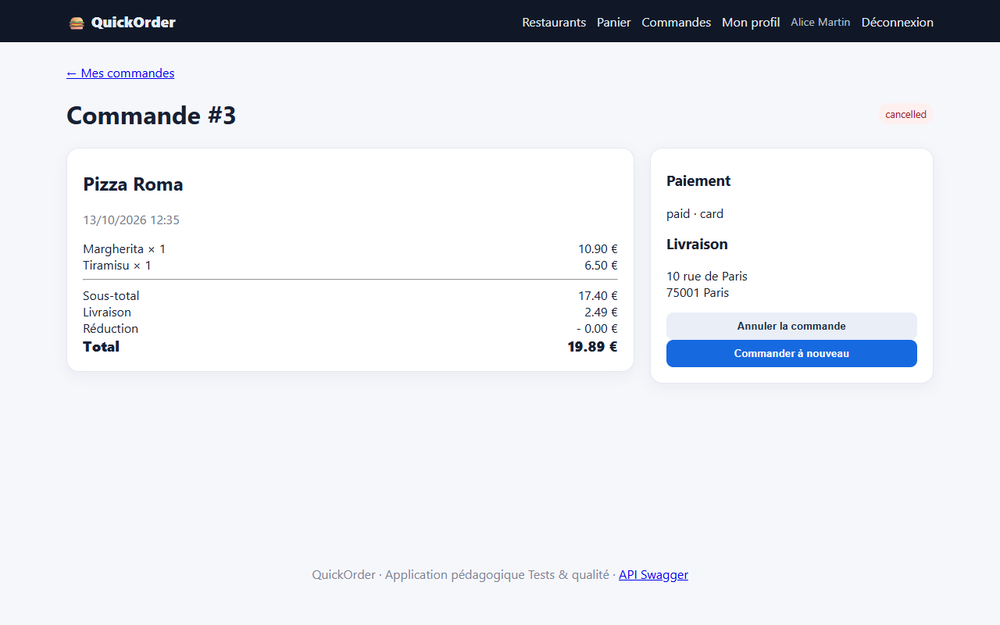

# BUG-11 : L'annulation d'une commande ne restitue ni le stock ni le paiement

| Sévérité | Priorité | Statut | Cas de test liés |
|---|---|---|---|
| Majeure | P2 | Ouvert | RM-10 |

## Contexte

Annulation d'une commande confirmée (API, même comportement dans l'interface).

Testé sur QuickOrder V3.1 sous Docker Compose (http://127.0.0.1:5000), base créée par seed.py, Microsoft Edge, le 13/10/2026.

## Préconditions

Clé API valide. Tiramisu (id 19) en stock.

## Étapes de reproduction

1. `GET /api/products/19` : noter le stock (99).
2. `POST /api/orders` avec 3 Tiramisu : stock 96.
3. `POST /api/orders/{id}/cancel`.
4. Relire le produit et la commande.

## Résultat attendu

Stock revenu à 99 ; paiement marqué remboursé.

## Résultat obtenu

Stock toujours à 96 ; commande #20 « cancelled » avec payment_status « paid ».

## Impact

Le client reste débité d'une commande annulée ; le stock disponible diminue à tort.

## Preuves



Échanges HTTP du cas RM-10 (fichier complet : [evidence/RM-10.txt](evidence/RM-10.txt))

```text
> GET /api/products/19
< 200 (application/json)
  {"available": true, "calories": 410, "category": "Desserts", "description": "Dessert italien au café", "id": 19, "is_vegetarian": true, "name": "Tiramisu", "price": 6.5, "restaurant_id": 4, "stock": 99}
> POST /api/orders
  body: {"items": [{"product_id": 19, "quantity": 3}], "payment_method": "card"}
< 201 (application/json)
  {"cash_received": null, "change_due": null, "created_at": "2026-10-13T12:35:26.987341", "delivery_fee": 2.49, "discount": 0.0, "id": 20, "items": [{"line_total": 19.5, "product_id": 19, "product_name": "Tiramisu", "quantity": 3, "unit_price": 6.5}], "payment_method": "card", "payment_status": "paid", "restaurant_id": 4, "status": "confirmed", "subtotal": 19.5, "total": 21.99}
> GET /api/products/19
< 200 (application/json)
  {"available": true, "calories": 410, "category": "Desserts", "description": "Dessert italien au café", "id": 19, "is_vegetarian": true, "name": "Tiramisu", "price": 6.5, "restaurant_id": 4, "stock": 96}
> POST /api/orders/20/cancel
< 200 (application/json)
  {"cash_received": null, "change_due": null, "created_at": "2026-10-13T12:35:26.987341", "delivery_fee": 2.49, "discount": 0.0, "id": 20, "items": [{"line_total": 19.5, "product_id": 19, "product_name": "Tiramisu", "quantity": 3, "unit_price": 6.5}], "payment_method": "card", "payment_status": "paid", "restaurant_id": 4, "status": "cancelled", "subtotal": 19.5, "total": 21.99}
> GET /api/products/19
< 200 (application/json)
  {"available": true, "calories": 410, "category": "Desserts", "description": "Dessert italien au café", "id": 19, "is_vegetarian": true, "name": "Tiramisu", "price": 6.5, "restaurant_id": 4, "stock": 96}
# RÉSULTAT ATTENDU : Stock revenu à sa valeur initiale ; payment_status passé à refunded (ou équivalent).
# RÉSULTAT OBTENU  : Stock 99 → 96 après commande → 96 après annulation ; statut cancelled ; payment_status « paid ».
# STATUT           : Fail
```
