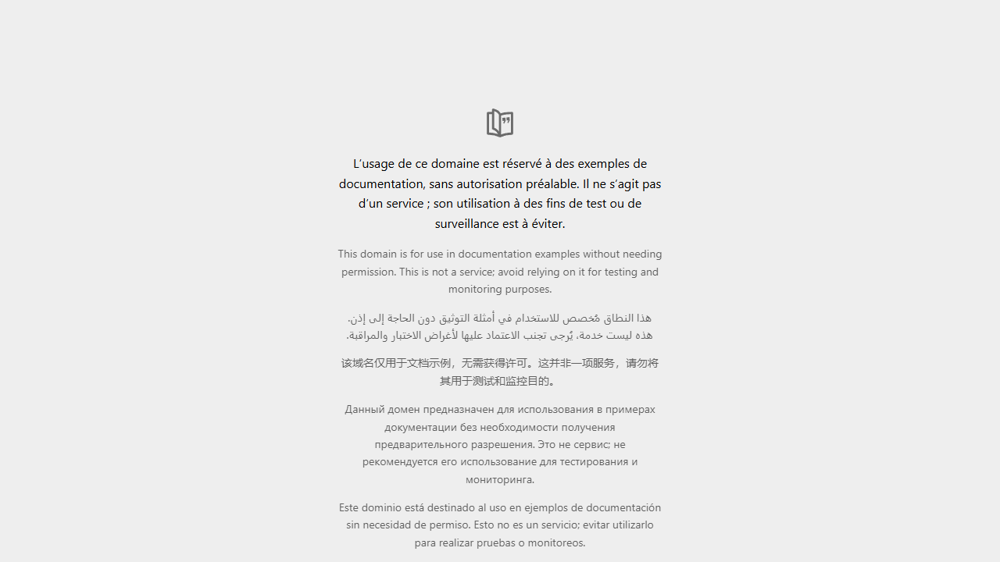

# BUG-12 : Redirection ouverte : le paramètre `next` de /login accepte une URL externe

| Sévérité | Priorité | Statut | Cas de test liés |
|---|---|---|---|
| Majeure | P2 | Ouvert | ERR-10 |

## Contexte

Sécurité. Formulaire de connexion.

Testé sur QuickOrder V3.1 sous Docker Compose (http://127.0.0.1:5000), base créée par seed.py, Microsoft Edge, le 13/10/2026.

## Préconditions

Compte alice@example.com existant, utilisateur déconnecté.

## Étapes de reproduction

1. Ouvrir `http://127.0.0.1:5000/login?next=https://example.org/phishing`.
2. Se connecter avec des identifiants valides.
3. Observer la réponse dans DevTools > Network.

## Résultat attendu

Redirection vers une page interne ; l'URL externe est ignorée.

## Résultat obtenu

HTTP 302 avec `Location: https://example.org/phishing` : le navigateur quitte le site juste après l'authentification. Relevé réseau du navigateur : [evidence/BUG-12-reseau-navigateur.txt](evidence/BUG-12-reseau-navigateur.txt).

## Impact

Hameçonnage : un lien QuickOrder légitime peut envoyer l'utilisateur, juste après sa connexion, vers un faux site qui lui redemande ses identifiants.

## Preuves



Échanges HTTP du cas ERR-10 (fichier complet : [evidence/ERR-10.txt](evidence/ERR-10.txt))

```text
> POST /login?next=https://example.org/phishing
< 302 /login?next=https://example.org/phishing Location: https://example.org/phishing
# RÉSULTAT ATTENDU : Redirection vers une page interne (accueil) ; l'URL externe est ignorée.
# RÉSULTAT OBTENU  : HTTP 302 ; Location : https://example.org/phishing.
# STATUT           : Fail
```
