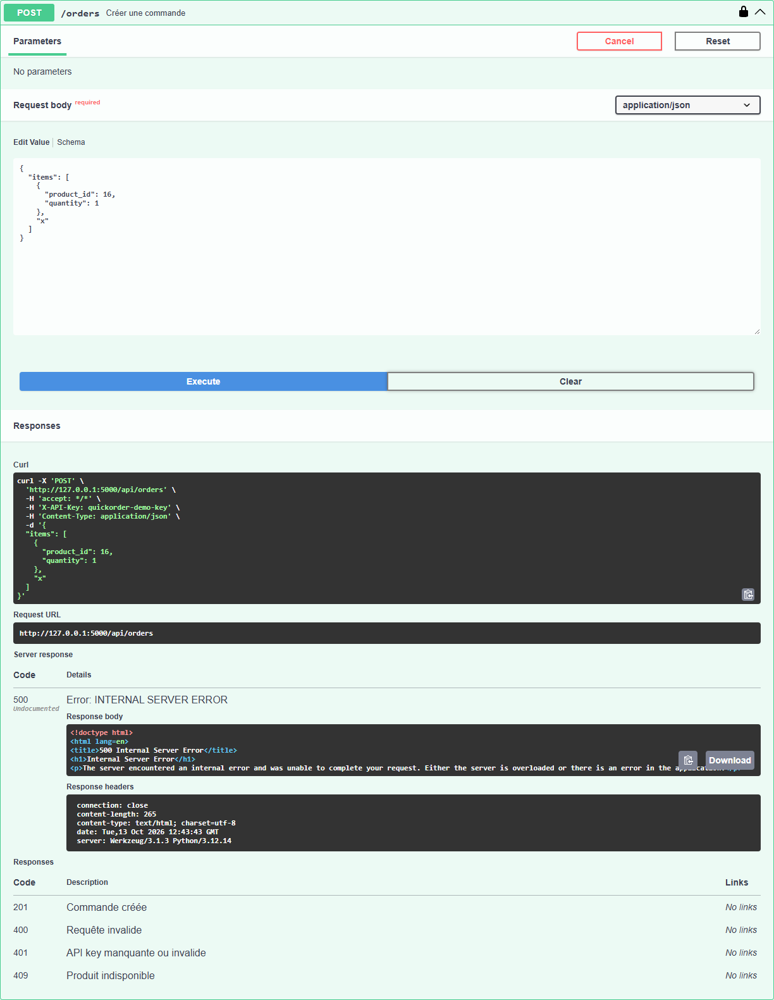

# BUG-13 : `POST /api/orders` répond 500 lorsqu'un élément de `items` n'est pas un objet

| Sévérité | Priorité | Statut | Cas de test liés |
|---|---|---|---|
| Moyenne | P3 | Ouvert | ERR-07 |

## Contexte

API REST, robustesse aux entrées invalides.

Testé sur QuickOrder V3.1 sous Docker Compose (http://127.0.0.1:5000), base créée par seed.py, Microsoft Edge, le 13/10/2026.

## Préconditions

Clé API valide.

## Étapes de reproduction

1. `POST /api/orders` avec `{"items":[{"product_id":16,"quantity":1},"x"]}`.

## Résultat attendu

HTTP 400 avec un message d'erreur JSON (comme pour un JSON invalide, une liste vide ou une quantité non numérique, qui renvoient bien 400).

## Résultat obtenu

HTTP 500 Internal Server Error, page HTML.

## Impact

Erreur serveur non maîtrisée déclenchable par n'importe quel client de l'API ; diagnostic impossible côté intégrateur.

## Preuves



Échanges HTTP du cas ERR-07 (fichier complet : [evidence/ERR-07.txt](evidence/ERR-07.txt))

```text
> POST /api/orders
  body (brut): {"items": [
< 400 (application/json)
  {"error": "items is required and must be a non-empty array"}
> POST /api/orders
  body: {"items": []}
< 400 (application/json)
  {"error": "items is required and must be a non-empty array"}
> POST /api/orders
  body: {"items": [{"product_id": 16, "quantity": "abc"}]}
< 400 (application/json)
  {"error": "quantity must be an integer"}
> POST /api/orders
  body: {"items": [{"product_id": 16, "quantity": 1}, "x"]}
< 500 (text/html; charset=utf-8)
# RÉSULTAT ATTENDU : HTTP 400 avec message d'erreur JSON pour les 4 requêtes.
# RÉSULTAT OBTENU  : Codes obtenus : a) 400  b) 400  c) 400  d) 500.
# STATUT           : Fail
```
