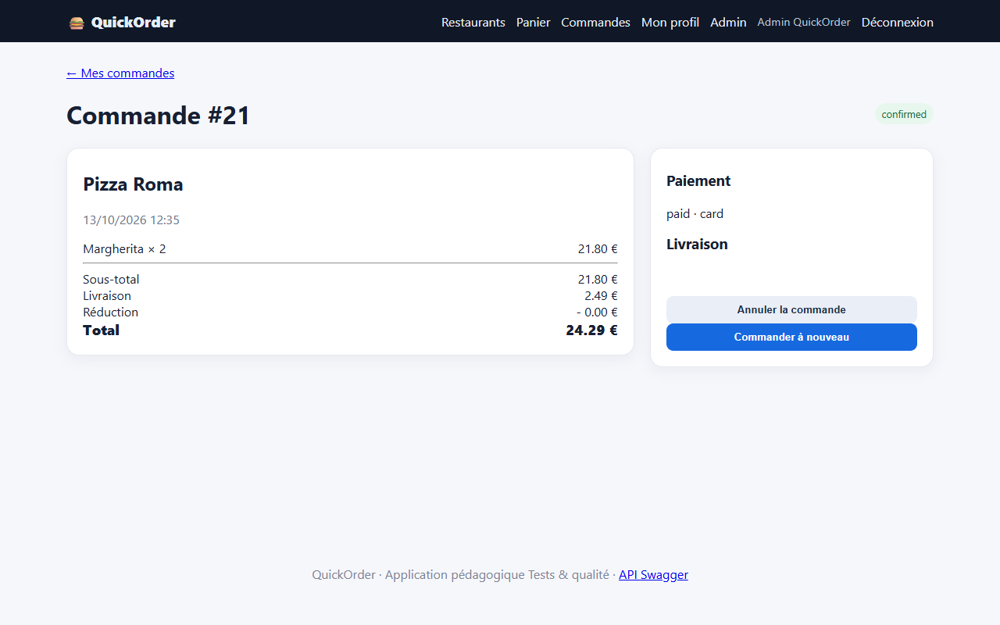

# BUG-15 : Un nouveau compte peut commander avec une adresse de livraison vide

| Sévérité | Priorité | Statut | Cas de test liés |
|---|---|---|---|
| Majeure | P1 | Ouvert | RM-13 |

## Contexte

Inscription puis première commande. L'inscription crée automatiquement une adresse « Domicile » dont la rue, le code postal et la ville sont vides.

Testé sur QuickOrder V3.1 sous Docker Compose (http://127.0.0.1:5000), base créée par seed.py, Microsoft Edge, le 13/10/2026.

## Préconditions

Aucun compte : créer un compte neuf.

## Étapes de reproduction

1. S'inscrire sur /register (nom, email, mot de passe).
2. Ajouter 2 Margherita au panier.
3. Passer commande : la liste « Adresse » propose « Domicile — , ».
4. Confirmer.

## Résultat attendu

Le checkout impose de renseigner rue, code postal et ville avant de confirmer.

## Résultat obtenu

Commande #21 confirmée et payée ; le bloc « Livraison » de la commande est vide.

## Impact

Commande payée impossible à livrer. Concerne tous les nouveaux inscrits, c'est-à-dire le parcours d'acquisition.

## Preuves



Échanges HTTP du cas RM-13 (fichier complet : [evidence/RM-13.txt](evidence/RM-13.txt))

```text
> POST /register
< 302 -> / ; 200 /
> POST /cart/clear
< 302 -> /cart ; 200 /cart
  message affiché : [info] Panier vidé.
> POST /cart/add/16
< 302 -> / ; 200 /
  message affiché : [success] Margherita ajouté au panier.
> GET /checkout
< 200 /checkout
# adresse proposée au checkout : «Domicile — ,»
> POST /checkout
< 302 -> /orders/21 ; 200 /orders/21
  message affiché : [success] Commande confirmée !
# adresse de livraison affichée sur la commande : «»
# RÉSULTAT ATTENDU : Le checkout exige la saisie d'une adresse (rue, code postal, ville) avant de confirmer.
# RÉSULTAT OBTENU  : Commande #21 confirmée avec l'adresse « Domicile » vide (rue, code postal et ville vides : «»).
# STATUT           : Fail
```
